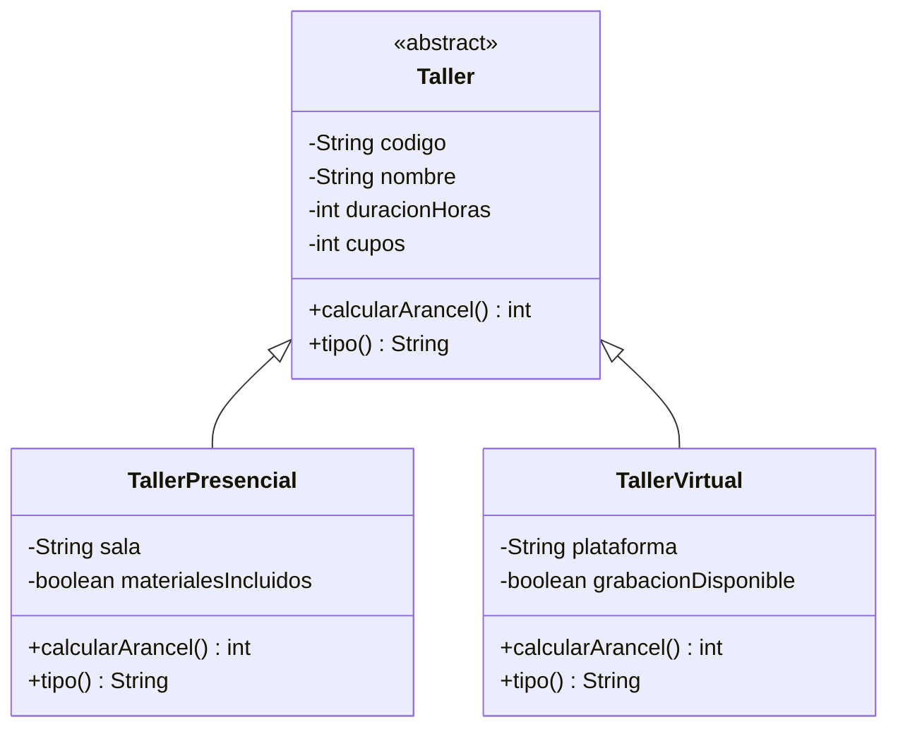

# Diagrama del modelo entregado

Ambos tipos representan talleres del mismo centro cultural, pero mantienen datos específicos y cálculos propios. Los valores ya se encuentran implementados en el modelo Java: **no reescribir las reglas ni los métodos de cálculo**.
